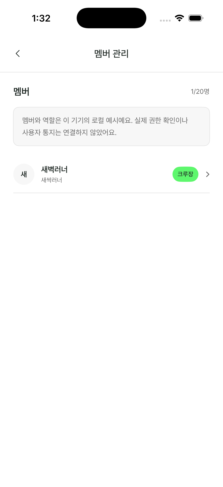
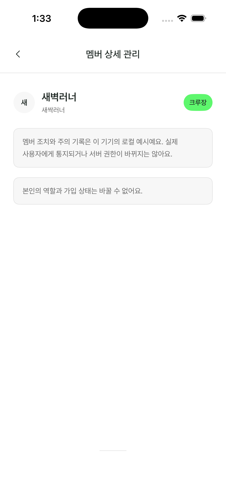

# C34–C35 Review55 evidence

## Baseline

- Source baseline: `ca5f7e6767ef2fab5c8ded9db8a3ffe6da3a4522` (`main` at task start).
- Installed app: `com.movtorun.mov`, version `1.0` (`CFBundleVersion` `1`). The project settings on the source baseline also specify `1.0` / build `1`.
- Simulator: the already-booted iPhone 17 Pro, iOS 26.3, `6EB4A7AD-63C1-471F-BB5F-9147DEEC404B`.
- The installed bundle does not include a Git revision, so its exact source commit cannot be proved from its version metadata alone. Its C19, C21, C34 and C35 screens were opened through the existing app flow and matched the corresponding source layout before this change.
- The Review55 reference was opened in the existing browser tab and reached through the C15 → C16 → C19 → C21 → C34 → C35 flow. C34 displays member name, role, and a chevron; C35 displays the selected name and role, then role/warning/removal controls only when the reference role rules allow them. The reference adds no capacity row or local-only disclaimer to these two screens.

## Simulator captures

These are display captures from the specified simulator, before and after the C34/C35 layout update.

| Screen | Before | After |
|---|---|---|
| C34 member list |  |  |
| C35 member detail |  | [Eligible member with warning/removal controls](c35-after-member-light.png); [crew owner restriction state](c35-after-owner-light.png) |

The updated C34 capture shows both crew members and their roles. C35 was captured for both an eligible member and the crew owner, confirming the role-gated controls and restriction state in the live app.

The focused UI test `testCommunityCrewMemberManagementUsesOwnerRoleAndLocalWarningAndRemoval` uses the local fixture to verify the selected member identity, owner role toggles in both directions, navigation back to C34, repeated local warnings, kick cancellation, and confirmed local removal. It passed 1/1 on the specified simulator (`/tmp/c34-c35-focused-3.xcresult`). No service calls are used for these interactions.
